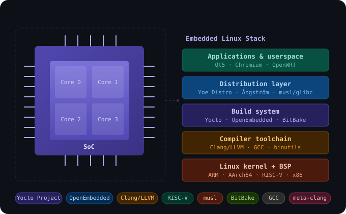

  

# Hi there 👋 I'm Khem Raj

> Embedded Linux engineer, open-source maintainer, and compiler toolchain specialist.  
> I work at the intersection of hardware and software — helping Linux run well on everything from tiny IoT devices to high-performance SoCs.

---

## 🧰 What I Work On

- **[Yocto Project](https://www.yoctoproject.org/)** — Core metadata maintainer
- **[OpenEmbedded](https://www.openembedded.org/)** — Main layer maintainer ([meta-openembedded](https://github.com/openembedded/meta-openembedded))
- **[meta-clang](https://github.com/kraj/meta-clang)** — Clang/LLVM cross-compiler layer for OE/Yocto
- **[Yoe Distro](https://github.com/YoeDistro/yoe-distro)** — Production-ready, customizable embedded Linux distribution
- **[meta-riscv](https://github.com/riscv/meta-riscv)** — OpenEmbedded/Yocto layer for RISC-V architecture
- **[meta-openwrt](https://github.com/kraj/meta-openwrt)** — OpenWRT overlay for OE/Yocto
- **[meta-raspberrypi](https://github.com/agherzan/meta-raspberrypi)** — Yocto layer for Raspberry Pi devices
- **[meta-freescale](https://github.com/Freescale/meta-freescale)** — NXP/Freescale BSP layer
- **[ct-scripts](https://github.com/kraj/ct-scripts)** — GCC cross-toolchain builder (glibc/musl/uclibc/baremetal)
- **[musl](https://github.com/kraj/musl)** — Contributions to the musl C standard library

---

## 🛠 Skills & Expertise

**Embedded Linux**
`Yocto Project` · `OpenEmbedded` · `BitBake` · `BSP development` · `Linux kernel`

**Compiler Toolchains**
`GCC` · `Clang/LLVM` · `binutils` · `glibc` · `musl` · `uClibc` · `cross-compilation`

**Architectures**
`ARM` · `AArch64` · `RISC-V` · `x86` · `MIPS` · `PowerPC`

**Languages & Tools**
`C` · `C++` · `Shell/Bash` · `Python` · `BitBake` · `Make` · `CMake`

**Systems & Distributions**
`musl libc` · `OpenWRT` · `Ångström` · `Yoe Distro` · `Debian`

---

## 📌 Pinned Repositories

| Project | Description | Stars |
|---|---|---|
| [meta-clang](https://github.com/kraj/meta-clang) | Clang/LLVM C/C++ cross compiler for OE/Yocto | ⭐ 86 forks |
| [meta-openwrt](https://github.com/kraj/meta-openwrt) | OE/Yocto metadata layer for OpenWRT | ⭐ 47 forks |
| [meta-altera](https://github.com/kraj/meta-altera) | Official Altera BSP layer for OE/Yocto | ⭐ 47 forks |
| [ct-scripts](https://github.com/kraj/ct-scripts) | GCC cross toolchain builder scripts | |
| [meta-riscv](https://github.com/kraj/meta-riscv) | RISC-V architecture layer for OE/Yocto | |

---

## 🏅 Highlights

- 🦺 **RISC-V Ambassador** — Certified by The Linux Foundation
- 🧊 **Arctic Code Vault Contributor** — GitHub's long-term open source archive
- 🎙️ Speaker at **RISC-V Summit** and **Embedded World**
- 🤝 Technical Advisory Board Member at **Beegol**
- 📦 Maintainer of `gcc`, `binutils`, `gdb`, `glibc`, `linux` recipes in OpenEmbedded since the early days

---

## 📫 Get in Touch

- 📧 raj.khem@gmail.com
- 💼 [LinkedIn](https://www.linkedin.com/in/khemraj/)
- 💰 [Sponsor my work on GitHub Sponsors](https://github.com/sponsors/kraj)

---

*If my work has helped your project, consider [sponsoring me](https://github.com/sponsors/kraj) to keep the open source ecosystem thriving!*
